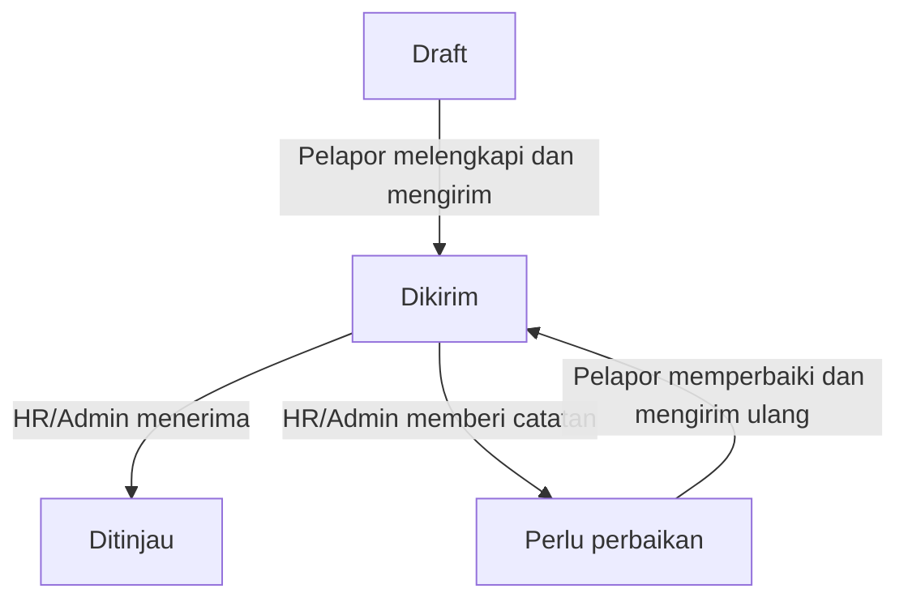

# PRD MASTER — NCUBATOR 3.0

**Nutrition Consultant Unified Base for Assessment, Training, Operations & Reporting**

Dokumen acuan produk, operasional, data, pengujian, dan serah terima pengembangan.

| Informasi | Nilai |
|---|---|
| Pemilik bisnis | Araia Group — PT. Enamdua Araia Kreasi |
| Nama produk | NCUBATOR |
| Pengguna | NC, TL, Admin, HR dan Client |
| Bahasa aplikasi | Bahasa Indonesia |
| Tanggal | 11 Oktober 2026, Asia/Jakarta |
| Versi source dan dokumen | 3.0.0 — pengembangan dari NC Retention V1 + add-on 2.1.1 |
| Stack | GitHub Pages, JavaScript vanilla, Apps Script, Sheets, Drive |
| Target kapasitas | 300+ akun terdaftar; aktivitas tersebar, kapasitas serentak perlu UAT produksi |
| Status | Source dan uji lokal tersedia; deployment pengguna belum diperbarui/diperiksa dalam sesi ini |
| Pemulihan akun | AdminRecovery.gs disertakan; tidak ada reset password produksi yang dijalankan |

Revisi ini mengikuti permintaan pemilik untuk memperbaiki loading/foto, mengganti nama menjadi NCUBATOR, menggunakan desain referensi putih–abu/biru, serta merapikan struktur untuk NC, TL, Admin dan Client. Data, akun, ID, riwayat, aturan skor, dan proses operasional lama tetap menjadi baseline. Penyebutan V1 pada aturan domain berarti fitur yang diteruskan, bukan tampilan atau versi produk terbaru.

## 1. Ringkasan produk

NCUBATOR adalah aplikasi Araia untuk mengelola personel NC, melihat sinyal risiko lebih awal, mencatat percakapan, membuat tindakan pendampingan, dan mengukur hasilnya. Aplikasi diperluas dengan database SPG milik Araia, riwayat pengalaman pada brand kompetitor, observasi pasar, laporan harian TL, serta analytics dan insight AI.

Database SPG menjadi sumber kandidat untuk NC baru. Setelah HR/Admin memilih dan memverifikasi kandidat, kandidat dapat dilanjutkan ke onboarding NC yang sudah ada. Riwayat talent tetap tersimpan dan pemantauan NC memakai aturan aplikasi sebelumnya.

Competitor & Market menyimpan tiga jenis informasi yang berbeda: pengalaman talent, temuan pasar, dan laporan kegiatan TL. Observasi serta laporan dapat diinput kapan saja sesuai tanggal kegiatan. Laporan dikirim untuk ditinjau HR/Admin; temuan pasar memiliki proses verifikasi tersendiri.

Analytics membantu tim memahami data yang sudah masuk. AI generatif memberi rekomendasi berdasarkan ringkasan agregat setelah penyedia AI dikonfigurasi. Keputusan rekrutmen, pendampingan, dan tindakan operasional tetap dilakukan manusia.

## 2. Masalah yang diselesaikan

| Masalah | Kebutuhan produk |
|---|---|
| Sinyal masalah NC terlambat terlihat | Input sinyal terstruktur, skor yang dapat dijelaskan, dan prioritas pendampingan |
| Percakapan dan tindak lanjut tersebar | Profil NC dengan riwayat percakapan, action plan, dan check-in |
| Kandidat SPG sulit dicari kembali | Database profil dengan foto, domisili, pengalaman, bidang, dan industri |
| Kandidat terpilih harus diinput ulang | Konversi SPG menjadi NC melalui alur onboarding lama |
| Pengalaman kompetitor bercampur dengan asumsi pasar | Riwayat pengalaman dipisahkan dari observasi pasar bersumber |
| Laporan TL tersebar di chat | Laporan harian dengan draft, kirim, tinjauan, koreksi, rekap, dan ekspor |
| Data banyak tetapi sulit dirangkum | Analytics aktual, pencocokan atribut kandidat, dan rekomendasi AI berbasis bukti agregat |
| Admin lupa password | Pemulihan akun melalui editor Apps Script menggunakan password baru pilihan pemilik |

## 3. Tujuan, ukuran keberhasilan, dan batas scope

### 3.1 Tujuan

1. Menjaga seluruh fungsi NC Retention yang sudah ada.
2. Menampung sekurangnya 1.000 profil SPG asli Araia, termasuk foto dan informasi pengalaman yang tersedia.
3. Memudahkan pencarian serta seleksi kandidat sesuai kebutuhan area, bidang, industri, dan pengalaman.
4. Melanjutkan kandidat terpilih menjadi NC tanpa membuat relasi atau akun ganda.
5. Mendokumentasikan kondisi kompetitor dan pasar dengan tanggal serta sumber yang dapat diperiksa.
6. Menyediakan laporan kegiatan harian TL yang dapat diisi di luar waktu kegiatan dan ditinjau kembali.
7. Menyediakan ringkasan yang membantu keputusan tanpa mengubah skor atau status personel secara otomatis.

### 3.2 Ukuran keberhasilan

| Ukuran | Definisi dan sumber | Sasaran / cara evaluasi |
|---|---|---|
| Database talent | Jumlah profil asli yang tercatat | Sekurangnya 1.000 profil setelah data Araia disiapkan dan diimport |
| Kelengkapan profil | Nama, domisili, provinsi, kontak HP, foto, bidang, industri, ringkasan pengalaman | Profil dapat disimpan bertahap; target operasional seluruh delapan unsur terisi untuk profil yang akan diseleksi |
| Integritas kandidat | Relasi SPG ke NC | Satu profil tidak menghasilkan NC kedua setelah konversi berhasil |
| Cakupan sinyal | Jumlah NC aktif yang memiliki sinyal menurut dashboard | Evaluasi terhadap periode dan kebutuhan operasional; angka cakupan tidak otomatis berarti input masih baru |
| Penyelesaian pendampingan | Action plan, penyelesaian tindakan, dan check-in | Dapat ditelusuri dari skor awal, hasil akhir, dan riwayat; target peningkatan bisnis ditetapkan Araia setelah baseline tersedia |
| Cakupan laporan TL | TL aktif yang memiliki laporan Dikirim/Ditinjau pada tanggal acuan | Dibandingkan dengan jadwal kerja aktual oleh tim; bukan ukuran absensi |
| Kualitas market intelligence | Observasi dengan sumber dan status verifikasi | Nominal benchmark hanya berasal dari observasi Terverifikasi |
| Batas akses | Hak akses server dan redaksi data | Tidak ada akses tulis Viewer atau akses lintas tim Supervisor yang tidak diizinkan |

Sistem belum memiliki bukti produksi untuk menetapkan persentase penurunan turnover, akurasi prediksi resign, SLA respons, atau jumlah pengguna serentak yang dijamin. Angka tersebut tidak dijadikan klaim produk.

### 3.3 Keputusan scope yang wajib dipertahankan

- Permintaan terbaru mengizinkan perubahan nama, tampilan, navigasi, kinerja, dan struktur. Batas sebelumnya untuk mempertahankan semua tampilan tidak berlaku pada area yang secara eksplisit diminta diubah.
- Data/akun/ID/riwayat, bobot dan ambang skor, approval cuti, onboarding dan lifecycle action plan lama dipertahankan.
- Frontend HTML/CSS/JavaScript vanilla dengan ES modules, hosting GitHub Pages; tanpa npm build produksi.
- Backend Apps Script Web App; Sheets sebagai penyimpanan; foto privat di Drive. Tidak menambah Firebase, hosting lain, GCP custom atau Advanced Services.
- Admin/HR/Supervisor/Viewer tetap digunakan dalam data. Label UI Supervisor menjadi TL, Viewer menjadi Client. Role NC ditambahkan dengan relasi profil terpisah.
- Logo PNG Araia asli dipertahankan. Wordmark produk, metadata browser dan header menjadi NCUBATOR.
- Migrasi menambahkan NC_User_Links; header 19 sheet inti lama dan tujuh sheet talent/market tidak diubah.

### 3.4 Di luar baseline ini

Sinkronisasi transaksi offline, Service Worker/PWA offline, login Google, HRIS, payroll, penjualan, inventori, GPS/absensi, pengiriman WhatsApp otomatis, keputusan rekrutmen otomatis, prediksi resign berbasis model, dan upload bukti laporan harian sebagai berkas bukan fitur baseline ini. Kebutuhan dari proyek Araia lain tidak otomatis menjadi kebutuhan aplikasi ini.

## 4. Pengguna dan hak akses

### 4.1 Peran

| Role tersimpan | Label UI | Tujuan utama |
|---|---|---|
| Admin | Admin | Seluruh operasional, akun, pengaturan dan audit |
| HR | HR | Personel/kandidat, verifikasi, konversi, tinjauan dan insight AI |
| Supervisor | TL | Tim yang ditugaskan, pendampingan dan laporan kegiatan sendiri |
| Viewer | Client | Ringkasan dan laporan yang diizinkan; tanpa perubahan |
| NC | NC | Portal pribadi: onboarding, tugas dan pengajuan sendiri |

### 4.2 Matriks akses

| Kemampuan | Admin | HR | Supervisor / TL | Viewer | NC |
|---|---|---|---|---|---|
| Baca data NC dan laporan V1 | Seluruh data | Seluruh data | NC yang ditugaskan | Baca sesuai aturan V1 | Profil/jadwal pribadi; tidak membaca laporan tim |
| Buat/edit data utama NC | Ya | Ya | Tidak | Tidak | Tidak |
| Input sinyal, onboarding, checklist, percakapan, plan | Ya | Ya | Tim sendiri | Tidak | Tidak |
| Pengajuan/proses izin dan cuti | Ya | Ya | Tim sendiri; level kedua terbatas | Tidak | Mengajukan milik sendiri; tanpa approval |
| Catat resign efektif | Ya | Ya | Tidak | Tidak | Tidak |
| Pengaturan, user, audit aplikasi | Ya | Tidak | Tidak | Tidak | Tidak |
| Baca profil SPG | Semua | Semua | Pool owner atau terkait NC dalam tim | Profil dengan redaksi kontak/internal | Tidak |
| Tambah/edit/import profil dan upload foto SPG | Ya | Ya | Tidak | Tidak | Tidak |
| Verifikasi dan konversi SPG menjadi NC | Ya | Ya | Tidak | Tidak | Tidak |
| Tambah/edit pengalaman SPG | Ya | Ya | Profil dalam akses | Tidak | Tidak |
| Baca observasi pasar | Semua | Semua | Milik sendiri dan Terverifikasi | Terverifikasi serta observasi lama miliknya | Tidak |
| Tambah/edit observasi pasar | Ya | Ya | Milik sendiri | Tidak | Tidak |
| Verifikasi pengalaman / observasi | Ya | Ya | Tidak | Tidak | Tidak |
| Isi/kirim laporan harian | Milik sendiri | Milik sendiri | Milik sendiri | Tidak | Tidak |
| Baca rekap dan detail laporan harian | Semua | Semua | Milik sendiri | Dikirim / Ditinjau | Tidak |
| Tinjau laporan Dikirim | Ya | Ya | Tidak | Tidak | Tidak |
| Ekspor/cetak laporan harian | Sesuai akses baca | Sesuai akses baca | Milik sendiri | Dikirim / Ditinjau | Tidak |
| Analytics dan pencocokan kandidat | Sesuai akses | Sesuai akses | Sesuai akses | Sesuai redaksi akses | Tidak |
| Buat insight AI | Ya | Ya | Tidak | Tidak | Tidak |
| Riwayat insight AI | Semua | Milik sendiri | Tidak | Tidak | Tidak |


Server memeriksa role, kepemilikan, dan status akun pada setiap akses. Mengubah role di browser tidak memberi hak tambahan. Supervisor pada modul NC dibatasi `NC.supervisor_id === user.user_id`; scope SPG berasal dari `owner_id` atau relasi NC yang ditugaskan.

Catatan percakapan sensitif NC hanya terbuka untuk Admin, HR, dan pembuat catatan. Catatan yang tidak ditandai sensitif mengikuti akses baca NC. Redaksi khusus Viewer pada profil SPG menghapus HP, email, catatan internal, external_id, dan owner_id; tugas/pencapaian pengalaman rinci juga disembunyikan. Redaksi tersebut tidak mengubah kontrak data profil NC V1.

NC terikat ke `NC_User_Links.user_id → nc_id`. Endpoint pribadi selalu menggunakan ID dari relasi server. NC tidak membaca NC lain, SPG, market, AI, percakapan, skor risiko internal, atau administrasi. Role NC hanya dapat menulis `request.submit` untuk profilnya sendiri. Penggantian relasi mengakhiri sesi yang tidak sesuai.

Client mempunyai empat menu utama; API baca legacy/redaksi tetap mengikuti matriks di atas. Penyembunyian menu tidak dipakai sebagai pengganti otorisasi server.

Hak akses langsung ke Google Sheets/Drive mengikuti izin file Google. Pembatasan aplikasi berlaku pada akses melalui API aplikasi.

## 5. Alur operasional utama

### 5.1 Talent menjadi NC

HR/Admin mengisi atau mengimport profil SPG → mencari/filter kandidat → memeriksa pengalaman dan data → menetapkan Terverifikasi → memilih Jadikan NC baru → mengisi area, Supervisor aktif, dan tanggal bergabung → NC masuk tahap Baru Bergabung → tim melanjutkan onboarding dan pemantauan V1.

### 5.2 Pendampingan NC

**DETECT → TALK → UNDERSTAND → ACT → FOLLOW UP → MEASURE.** Input sinyal menghasilkan skor; tim membahas kondisi melalui percakapan, mencatat akar masalah, membuat action plan 30 hari, melakukan check-in, lalu menutup plan berdasarkan hasil. Sistem tidak mengeluarkan personel secara otomatis.

### 5.3 Informasi kompetitor dan pasar

Pengalaman kerja dicatat di profil talent. Observasi dicatat setiap ada temuan pasar. Laporan harian merangkum kegiatan pelapor pada tanggal/area tertentu. Pengalaman kerja pada brand tidak otomatis membuktikan fakta pasar; laporan Ditinjau tidak otomatis mengubah observasi menjadi Terverifikasi.

### 5.4 Laporan harian TL



### 5.5 Insight

Pengguna membuka analytics untuk membaca agregat dan analisis otomatis. HR/Admin dapat memilih fokus lalu meminta insight AI jika konfigurasi tersedia. Hasil menampilkan bukti agregat, disimpan dalam riwayat, dan menjadi bahan tinjauan manusia.

### 5.6 Portal pribadi NC

Admin memilih role NC dan menghubungkan ID profil → NC login → Beranda Saya menampilkan kondisi pribadi → Onboarding Saya untuk jadwal/hasil/checklist → Pengajuan Saya untuk izin/cuti → Tugas Saya untuk tindakan yang sudah ditetapkan. TL/HR memperbarui assessment, checklist dan penyelesaian tindakan. NC tidak melakukan penilaian atau approval terhadap dirinya sendiri.

### 5.7 Navigasi tunggal per alur

| Menu | Tab / fungsi | Peran |
|---|---|---|
| Beranda | Ringkasan dan prioritas | Admin, HR, TL, Client |
| Database SPG | Profil, import, pengalaman, seleksi, konversi | Admin, HR, TL sesuai scope |
| Onboarding | Tahapan; Kesiapan 30/60/90 hari | Admin, HR, TL |
| Tim NC | Direktori dan profil | Admin, HR, TL, Client |
| Izin & Cuti | Daftar pengajuan; Kalender tim | Admin, HR, TL |
| Competitor & Market | Laporan harian (awal); Observasi pasar; Pengalaman kompetitor | Admin, HR, TL, Client |
| Retensi & Follow-up | Risiko; Input sinyal; Percakapan; Action plan; Tindak lanjut | Admin, HR, TL |
| Laporan & Insight | Laporan bulanan; Papan retensi; Resign; Analytics & AI | Admin, HR, TL, Client |
| Administrasi | Akun & akses; Pengaturan; Audit log | Admin |
| Portal NC | Beranda Saya; Onboarding Saya; Pengajuan Saya; Tugas Saya | NC |

Database SPG adalah kandidat, Tim NC adalah personel aktif. Onboarding menyiapkan personel; retensi mendampingi kondisi personel. Laporan harian mendokumentasikan aktivitas TL; sinyal mingguan memberi masukan skor risiko. Link hash lama tetap dikenali sebagai tab. Menutup drawer profil kembali ke halaman asal. Pada ponsel, Menu tambahan hanya muncul bila ada tujuan lain.

## 6. Kebutuhan fungsional — akun dan modul NC V1

### FR-AUTH-01 — Login produksi dan sesi

- Login membutuhkan POST username/password; password dihash dengan salt dan AUTH_PEPPER server, bukan PIN plaintext.
- Sesi berupa token acak, maksimal enam jam. Logout membuang token; status/role/hash akun diperiksa ulang pada setiap request.
- Auth menggunakan petunjuk posisi baris untuk membaca satu baris Users terbaru. Jika baris berpindah atau sesi lama belum menyimpan petunjuk, server membaca sumber dan memperbarui petunjuk; ID baris selalu diperiksa.
- Respons login 3.0 membawa `user`, `token`, `expires`, dan `context` ringan. UI memakai context itu dan meminta halaman awal sekali. Login→Dashboard memakai dua permintaan pada uji browser.
- Delapan percobaan login gagal memicu pembatasan 15 menit. Produksi tidak menggunakan password demo browser.

### FR-AUTH-02 — User, relasi NC, dan pemulihan Admin

- Admin mengelola akun, keaktifan, role dan password 8–200 karakter; tidak dapat menonaktifkan/menurunkan role sendiri ketika sedang login.
- Role NC wajib mempunyai `nc_id` valid. Satu profil terhubung ke satu user; relasi disimpan di NC_User_Links tanpa menambah kolom pada Users.
- Perubahan relasi, password, role atau keaktifan menolak sesi yang tidak lagi sesuai. Jika role NC diganti, relasi lama dikosongkan.
- AdminRecovery.gs disertakan: reset melalui editor proyek asli dan Script properties; tidak ada endpoint reset publik atau password Admin produksi bawaan.

### FR-SELF-01 — Portal pribadi NC

- Endpoint `self.home`/`self.training` menampilkan profil dasar, jadwal training, hasil assessment, checklist kesiapan, jumlah pengajuan menunggu dan tugas belum selesai.
- `self.requests` menampilkan saldo cuti dan pengajuan pribadi dengan pagination. Pengajuan memakai `request.submit` yang sama dengan proses approval lama; server menolak ID NC lain dan semua aksi approval/evaluasi dari role NC.
- `self.tasks` menampilkan tindakan, PIC, due date dan status penyelesaian dari plan aktif miliknya. NC tidak mendapatkan akar masalah, percakapan, catatan evaluasi, skor risiko/initial score atau data tim lain.
- NC membaca hasil; TL/HR/Admin mencatat penilaian, checklist dan progres tindakan. Akun tidak otomatis dibuat hanya karena SPG dikonversi; Admin menghubungkan akun secara eksplisit.

### FR-NC-01 — Data dan profil NC

Admin/HR membuat atau mengubah nama, area, Supervisor aktif, tanggal bergabung, HP, dan catatan NC. Tanggal bergabung tidak boleh di masa depan. NC baru berstatus kerja Aktif dan onboarding Baru Bergabung. Data NC resign menjadi riwayat yang dapat dibaca, dengan perubahan operasional aktif ditolak.

Profil NC mempunyai enam tab: ringkasan, sinyal, percakapan, action plan, izin/cuti, onboarding. Data tab dimuat sesuai kebutuhan, bukan seluruh detail di awal. Ringkasan memuat skor, status, kontribusi kategori, timeline, dan keberadaan plan aktif.

**Penerimaan:** data valid tersimpan; Supervisor tidak dapat membuat data utama NC; akses profil di luar tim ditolak; riwayat resign tetap dapat ditemukan.

### FR-DASH-01 — Dashboard

Dashboard memuat jumlah NC aktif, pembagian Low/Moderate/High, onboarding, pengajuan tertunda, tindak lanjut, distribusi area, tren sampai 12 minggu, serta paling banyak delapan NC prioritas. Agregat mengikuti scope akun; tabel dan agregat dimuat terpisah sesuai kebutuhan.

**Penerimaan:** angka sesuai data dalam akses; periode tanpa snapshot tidak diganti dengan nilai risiko rekaan; prioritas dan link profil dapat dibuka.

### FR-RISK-01 — Sinyal dan skor risiko

Enam severity berupa bilangan bulat 0–3: Attendance, Commitment, Performance, Execution, Engagement, Employee Support. Input mencatat NC, periode, pembuat, waktu, dan catatan. Periode diseragamkan ke awal minggu Senin. Sinyal historis tidak menggeser penilaian minggu sekarang secara keliru.

| Kategori | Bobot default |
|---|---:|
| Attendance | 25 |
| Performance | 25 |
| Commitment | 15 |
| Employee Support | 15 |
| Execution | 10 |
| Engagement | 10 |
| Total | 100 |

`score = round(sum((severity efektif / 3) × bobot kategori))`.

Severity Attendance efektif adalah severity input ditambah `floor(jumlah izin Disetujui dalam permitWindow / permitCount)`, dengan maksimum 3. Default permitWindow adalah 30 hari dan permitCount adalah 3. Tambahan ini menghitung jumlah pengajuan izin yang disetujui, bukan jumlah hari cuti.

| Score default | Status |
|---|---|
| 0–29 | Low |
| 30–59 | Moderate |
| 60–100 | High |

Bobot dan ambang dapat diubah melalui konfigurasi Admin yang tervalidasi; total bobot wajib 100. Masa kritis onboarding menjadi flag, bukan tambahan skor otomatis. Matching talent, laporan harian, observasi pasar, dan AI tidak mengubah formula ini.

Import sinyal V1 menerima TSV dengan preview dan maksimum 200 baris. Seluruh baris divalidasi sebelum commit. Snapshot risiko dan peristiwa High disimpan untuk riwayat deteksi.

**Penerimaan:** batas status tepat; severity di luar 0–3 ditolak; import invalid tidak menyimpan baris valid sebagian akibat validasi; skor yang ditampilkan dapat dijelaskan dari kontribusi kategori.

### FR-ONB-01 — Onboarding dan kesiapan NC baru

Tahap yang tersedia: Baru Bergabung, Training, Assessment, Perlu Ulang, Sudah Training (Lulus), Aktif Lapangan. Sistem menyimpan jadwal training, trainer, tanggal/nilai assessment, hasil, dan log perubahan tahap beserta actor.

Default nilai lulus assessment adalah 70 dari 100. Tahap Sudah Training (Lulus) atau Aktif Lapangan memerlukan hasil Lulus dan tanggal assessment yang sudah terjadi. Perlu Ulang memerlukan hasil assessment Ulang.

Default Training lebih dari 14 hari dan Assessment lebih dari tujuh hari ditandai tertahan. NC dengan masa kerja kurang dari 90 hari ditandai masa kritis. Checklist awal terdiri atas kontrak, akun/ID, seragam/alat, orientasi, shadowing, dan assessment; Admin dapat mengatur checklist. Check-in onboarding dicatat untuk hari 30, 60, dan 90 dengan status On track, Perlu penyesuaian, atau Eskalasi.

**Penerimaan:** transisi kelulusan tanpa assessment valid ditolak; tahap/riwayat tampil; checklist menunjukkan jumlah selesai; check-in dalam scope tersimpan.

### FR-REQ-01 — Izin dan cuti

Jenis izin: Sakit, Keperluan keluarga, Dinas/lainnya. Jenis cuti: Tahunan, Melahirkan, Menikah, Lainnya. Form memuat tanggal mulai/selesai, alasan, dan link lampiran HTTPS opsional. Pengajuan tanggal lampau hanya dapat dibuat Admin.

Perhitungan menggunakan hari kalender termasuk akhir pekan. Kuota default cuti tahunan adalah 12 hari/tahun; kuota per NC dapat berasal dari Leave_Balance. Hanya cuti Tahunan mengurangi kuota tahunan. Pengajuan Diajukan/Menunggu HR mencadangkan saldo; Ditolak melepaskan cadangan. Rentang lintas tahun dihitung pada masing-masing tahun. Cuti yang bertabrakan dengan pengajuan lain yang belum ditolak ditolak.

Approval default satu level. Jika dua level diaktifkan untuk cuti, persetujuan pertama berubah menjadi Menunggu HR dan final approval dilakukan user HR/Admin yang berbeda dari approver pertama. Status tersedia: Diajukan, Menunggu HR, Disetujui, Ditolak. Kalender menampilkan kapasitas area berdasarkan konfigurasi; indikator kapasitas tidak boleh dijelaskan sebagai absensi.

**Penerimaan:** validasi tanggal/saldo/bentrok bekerja; final approval mengurangi saldo; level kedua dari user yang sama ditolak; izin disetujui memengaruhi Attendance sesuai aturan V1.

### FR-CONV-01 — Percakapan dan akar masalah

Admin/HR/Supervisor mencatat percakapan dengan tanggal yang sudah terjadi, kategori akar masalah, catatan, serta penanda sensitif. Kategori mencakup kompensasi/payroll, jadwal, target, hubungan dengan atasan, jarak/transport, personal, tawaran lain, dan lainnya.

Penyembunyian catatan sensitif dilakukan di server. Daftar percakapan menggunakan metadata; isi rinci dibaca dari profil. Catatan percakapan tidak disimpan ke sessionStorage browser atau dikirim ke AI.

**Penerimaan:** pihak tanpa izin melihat penanda catatan terbatas; pihak berhak dapat membaca; catatan tidak muncul dalam ekspor laporan bulanan atau payload AI.

### FR-PLAN-01 — Action plan dan check-in

NC aktif dapat mempunyai satu action plan aktif. Plan berdurasi 30 hari dengan 1–5 tindakan, PIC, due date dalam rentang plan, target skor, akar masalah opsional, dan initial_score yang disimpan ketika dibuat. Check-in tersedia pada hari 7, 14, 21, dan 30.

Tindakan dapat ditandai selesai selama plan aktif. Plan ditutup dengan hasil Pulih atau Tetap; final_score dan waktu penutupan disimpan sehingga hasil historis tidak ikut bergeser ketika skor NC berubah. Resign efektif dapat menutup plan dengan hasil Resign.

**Penerimaan:** plan aktif kedua ditolak; due date di luar 30 hari ditolak; progress dan check-in tampil; hasil plan selesai tetap stabil.

### FR-ATTR-01 — Attrition Log

Admin/HR mencatat tanggal pengajuan resign, tanggal efektif, alasan, dan catatan. Tanggal efektif harus setelah atau sama dengan tanggal resign dan sudah terjadi. Sistem menyimpan masa kerja serta penanda pernah High Risk dan pernah mempunyai plan sebelum resign.

NC berpindah menjadi Resign, keluar dari daftar aktif, dan tetap mempunyai riwayat. Sistem tidak menjadwalkan resign efektif di masa depan.

**Penerimaan:** periode invalid ditolak; daftar aktif diperbarui; riwayat sinyal, percakapan, onboarding, dan plan tetap dapat ditelusuri.

### FR-REPORT-01 — Papan retensi, laporan bulanan, dan pengingat

Papan Retensi membandingkan kelompok Supervisor atau area pada periode yang tersedia; tidak membuat peringkat individual NC. Laporan Bulanan menampilkan agregat, onboarding, izin/cuti, attrition, serta detail High Risk sesuai periode dan scope.

Laporan Bulanan mendukung salin ringkasan, CSV dari tabel yang telah dimuat, dan cetak A4/Save as PDF melalui browser. Isi percakapan sensitif tidak diekspor. Aturan CSV V1 ini berbeda dari ekspor laporan harian TL yang mengambil seluruh halaman sesuai filter.

Pengingat menampilkan tindakan/check-in tertunda, assessment, pengajuan yang belum diproses, dan kebutuhan kesiapan NC. Tautan WhatsApp hanya membuka pesan yang disiapkan; pengguna menentukan penerima dan mengirim sendiri. Trigger dailyRefresh opsional mempertahankan perilaku V1 dan dijadwalkan sekitar pukul 07.00 WIB jika diinstall.

**Penerimaan:** pengelompokan dan periode berjalan; print mengikuti scope; tidak ada pengiriman WhatsApp otomatis; laporan TL tidak menimpa laporan NC lama.

### FR-CFG-01 — Pengaturan dan audit

Admin mengubah konfigurasi yang telah tersedia: bobot/ambang risiko, masa kritis, batas tahap onboarding, izin, cuti, kapasitas area, nilai lulus, checklist, dan template pengingat. Audit menyimpan waktu, actor, aksi, entitas, ID, dan ringkasan, dengan pagination.

**Penerimaan:** role selain Admin ditolak; konfigurasi invalid ditolak; perubahan yang didukung menghasilkan catatan audit tanpa password mentah.

## 7. Kebutuhan fungsional — database SPG

### FR-SPG-01 — Profil dan pencarian

Database mendukung jumlah keseluruhan lebih dari 1.000 profil. Batas 1.000 berlaku pada satu import. Daftar menggunakan pagination, pencarian, dan filter domisili, provinsi, sektor/industri, bidang, pengalaman minimum, ketersediaan, dan verifikasi.

| Data | Aturan |
|---|---|
| spg_id | ID internal otomatis; tidak mengganti external_id Araia |
| external_id | ID Araia, unik jika terisi; wajib untuk import/upsert berulang |
| Nama, domisili, provinsi | Wajib saat menyimpan profil |
| Bidang | Minimal satu dari delapan pilihan; dapat memilih beberapa |
| Industri | Minimal satu dari 19 kode; dapat memilih beberapa |
| Pengalaman | experience_years 0–60, boleh desimal; experience_summary untuk ringkasan |
| HP | Opsional saat simpan, input 8–16 angka; awalan 0 dinormalisasi menjadi 62; duplikat profil ditolak |
| Email | Opsional, format email tervalidasi |
| Foto | Upload privat atau foto_url HTTPS; foto yang belum tersedia ditampilkan sebagai inisial |
| Status | Tersedia, Dipertimbangkan, Tidak tersedia, Menjadi NC, Arsip |
| Verifikasi | Belum diverifikasi atau Terverifikasi; penetapan Terverifikasi hanya HR/Admin |
| owner_id | Opsional, harus Supervisor aktif jika terisi |
| nc_id | Diisi oleh proses konversi; tidak dibuat manual melalui perubahan status |
| Catatan dan metadata | Catatan internal, pembuat, waktu dibuat/diperbarui |

Kelengkapan profil dihitung dari delapan unsur: nama, domisili, provinsi, HP, foto, bidang, industri, ringkasan pengalaman. Skor kelengkapan mengukur isi atribut, bukan kualitas atau kemampuan talent. Profil parsial dapat disimpan jika validasi wajib terpenuhi.

**Penerimaan:** data tersimpan dan dapat dicari; external_id/HP ganda ditolak; filter memakai data aktual; empty state tidak menampilkan kandidat rekaan; akses Supervisor dan redaksi Viewer bekerja.

### FR-SPG-02 — Import CSV/TSV

HR/Admin dapat mengunggah atau menempel tabel, melihat preview, dan melakukan import 1–1.000 baris. Header wajib: `external_id`, `nama`, `domisili`, `provinsi`, `bidang`, `industri`. Header lain yang didukung tercantum dalam template `templates/ARAIA_SPG_Import_Template.csv`.

Bidang/industri lebih dari satu dipisahkan titik koma. Bidang memakai label persis; industri memakai kode pada Lampiran A. Parser mendukung CSV dengan kutip, newline di dalam cell, dan TSV. Jumlah kolom per baris serta header duplikat diperiksa.

external_id yang sudah ada memperbarui profil yang sama. Riwayat pengalaman, photo_file_id upload, nc_id, dan relasi konversi tidak dihapus oleh import profil. Foto URL dan informasi profil yang diberikan pada import tetap mengikuti aturan pembaruan form/import; ID konsisten wajib dipakai. Untuk profil Menjadi NC, status import dikosongkan atau tetap Menjadi NC.

Seluruh baris divalidasi sebelum commit. Pesan invalid menyebut baris yang perlu diperbaiki; hasil sukses menampilkan jumlah baru/diperbarui. Tidak ada pengisian otomatis 1.000 identitas atau foto sintetis.

**Penerimaan:** import 1.000 profil valid berhasil pada pengujian; import ulang dengan ID sama tidak menggandakan profil; satu baris invalid membatalkan penulisan akibat validasi; duplikasi ID/HP pada file atau database ditolak.

### FR-SPG-03 — Foto profil

- Foto dapat dipilih ketika menambah/edit profil dan melalui Upload foto di detail.
- JPG/PNG/WebP maksimal 12 MB sebelum kompresi; browser mengecilkan sisi terpanjang menjadi 384 px dan mengubah menjadi JPEG kualitas 0,78. Backend menerima maksimal 600 KB, memeriksa MIME dan signature.
- Profil disimpan sebelum upload. Jika upload gagal, UI menyatakan profil sudah tersimpan dan retry memakai profil/requestId yang sesuai; tidak membuat kandidat baru kedua.
- Drive tetap privat. Endpoint `talent.photo` memeriksa sesi dan scope SPG sebelum membaca gambar. Link HTTPS opsional tetap didukung.
- Pemicu IntersectionObserver mengamati wadah avatar; gambar memakai eager loading saat dipicu. Native lazy loading pada gambar hidden dihapus agar tidak menunggu layout yang belum ada.
- Foto baru langsung memakai byte hasil kompresi lokal setelah server berhasil menyimpan. Cache client dibatasi 80 versi; versi mengikuti updated_at. Cache asset server berdasarkan file Drive dipakai setelah pemeriksaan akses profil.
- File foto lama tidak ditulis ulang selama upgrade. Kegagalan file/izin menampilkan inisial dan penjelasan pada avatar.

### FR-SPG-04 — Konversi menjadi NC baru

HR/Admin memilih profil berstatus Tersedia atau Dipertimbangkan dan Terverifikasi. Form konversi meminta area penempatan, Supervisor aktif, serta tanggal bergabung yang tidak di masa depan.

Konversi memanggil aturan `nc.save` V1, membuat NC Aktif/Baru Bergabung, memperbarui SPG menjadi Menjadi NC, menyimpan nc_id dan owner_id Supervisor, serta mencatat SPG_NC_Links dan audit. Profil SPG, foto, dan pengalaman tetap tersedia. Aplikasi membuka profil NC hasil konversi untuk melanjutkan proses lama.

Jika nomor HP sudah tercatat pada NC lain, konversi dihentikan untuk pemeriksaan HR. Jika profil sudah memiliki NC valid, permintaan ulang mengembalikan NC tersebut. Status Menjadi NC tidak dapat dipasang tanpa konversi atau dilepas melalui edit profil biasa.

**Penerimaan:** kandidat valid menghasilkan satu NC; relasi dapat ditelusuri; pengulangan setelah konversi berhasil tidak menghasilkan NC kedua; profil belum terverifikasi atau tidak tersedia ditolak.

## 8. Kebutuhan fungsional — Competitor & Market

| Jenis data | Sumber utama | Tujuan | Hubungan dengan verifikasi |
|---|---|---|---|
| Pengalaman kompetitor | Riwayat kerja talent | Melihat pengalaman perusahaan/brand | Memiliki status verifikasi pengalaman |
| Observasi pasar | Temuan lapangan, wawancara, laporan publik | Mencatat kondisi dan informasi pasar | Memiliki status verifikasi fakta/nominal |
| Laporan harian TL | Rekap kegiatan pelapor | Dokumentasi dan tindak lanjut operasional | Status Ditinjau berarti tinjauan laporan, bukan otomatis verifikasi fakta pasar |

### FR-EXP-01 — Pengalaman talent dan kompetitor

Pengalaman terhubung ke spg_id dan memuat perusahaan/agency, brand, industri, bidang, posisi, channel, tanggal mulai/selesai, penanda masih bekerja, tugas, pencapaian, penanda kompetitor, serta verifikasi.

Tanggal mulai tidak boleh di masa depan. Jika masih bekerja, tanggal selesai kosong; jika sudah selesai, periode harus berurutan dan tidak di masa depan. Admin/HR mengelola pengalaman; Supervisor dapat mencatat/mengubah pengalaman profil yang berada dalam aksesnya. Viewer hanya menerima informasi dasar dengan redaksi tugas/pencapaian.

Pengalaman bertanda kompetitor masuk tab Pengalaman kompetitor. Data ini digunakan sebagai pengalaman kandidat, bukan estimasi kondisi pasar yang sedang berlaku.

**Penerimaan:** beberapa pengalaman per profil tersimpan; periode invalid ditolak; label kompetitor dapat difilter; verifikasi memerlukan HR/Admin.

### FR-MKT-01 — Observasi pasar kapan saja

Form memuat judul, tanggal observasi, area/kota, industri, brand, topik, uraian temuan, jenis sumber, referensi sumber, verifikasi, dan nominal opsional. Tanggal observasi boleh hari ini atau sebelumnya; tanggal masa depan ditolak. Tidak ada batas jam input.

Jenis sumber: Observasi lapangan, Wawancara, Laporan publik. Referensi wajib diisi berupa identitas dokumen/wawancara yang dapat diperiksa atau URL HTTPS. Daftar topik tersedia di Lampiran A.

Nominal minimum dan maksimum harus sama-sama diisi atau sama-sama kosong. Jika diisi, nilai 0–1.000.000.000 dan minimum tidak melebihi maksimum, dengan periode Harian, Bulanan, atau Program. Frontend menyebut nominal Rp; sistem tidak mempunyai konversi mata uang.

Supervisor hanya mengubah observasi miliknya dan tidak dapat menetapkan Terverifikasi. Pembaruan oleh Supervisor disimpan dengan verifikasi yang perlu ditinjau kembali. Filter baca baseline untuk akun selain Admin/HR adalah observasi Terverifikasi atau observasi yang created_by-nya sama dengan akun login. Dengan demikian, Viewer juga dapat membaca observasi lama yang pernah dibuatnya sebelum perubahan role; hak tersebut tidak memberikan akses tulis.

Benchmark memakai minimum/maksimum dari observasi Terverifikasi, dikelompokkan per industri dan periode nominal. Rentang tersebut merupakan rentang sumber yang tercatat, bukan penetapan tarif atau statistik representatif seluruh pasar.

**Penerimaan:** observasi dapat disimpan terpisah dari pengalaman talent dan laporan harian; sumber wajib; nominal invalid ditolak; satuan tidak dicampur; hak edit/verifikasi dipatuhi.

### FR-TL-01 — Form laporan harian

Pelapor menggunakan akun Supervisor/TL. Admin dan HR juga dapat membuat laporan miliknya sendiri. Nama serta ID pelapor berasal dari akun login, bukan dropdown untuk mengisi atas nama TL lain.

| Isian | Draft | Wajib sebelum Dikirim |
|---|---|---|
| Tanggal kegiatan | Wajib; tidak di masa depan | Ya |
| Area | Wajib | Ya |
| Industri | Wajib | Ya |
| Outlet/lokasi dan brand | Opsional | Opsional |
| Jumlah kunjungan outlet | Bilangan bulat 0–10.000; default 0 | Nilai valid |
| Ringkasan kegiatan | Opsional | Ya |
| Kondisi pasar | Opsional | Ya |
| Aktivitas kompetitor | Opsional | Ya; boleh menjelaskan tidak ada temuan |
| Promo/harga dan kendala | Opsional | Opsional |
| Tindak lanjut | Opsional | Ya |
| Jenis dan referensi sumber | Opsional | Ya |
| Link bukti HTTPS | Opsional | Opsional |

Draft minimal tanggal, area, industri. Narasi menggunakan batas panjang yang tervalidasi; bukti berupa link, bukan upload dokumen melalui modul laporan ini. Waktu dibuat, dikirim, ditinjau, dan diperbarui dicatat otomatis dan terpisah dari tanggal kegiatan.

Satu laporan unik untuk satu pelapor, tanggal, dan area; perbandingan area pada validasi duplikat tidak membedakan kapitalisasi. Beberapa outlet dalam area sama digabung pada laporan tersebut. Area berbeda dapat mempunyai laporan lain pada tanggal sama. Input kegiatan kemarin atau tanggal sebelumnya diperbolehkan tanpa batas jam penutupan laporan.

**Penerimaan:** draft parsial valid tersimpan; kirim tanpa enam isian narasi/sumber wajib ditolak; pelapor tidak dapat mengisi atas nama orang lain; tanggal masa depan dan laporan duplikat ditolak.

### FR-TL-02 — Status, tinjauan, dan revisi

| Status | Aksi pelapor | Aksi HR/Admin |
|---|---|---|
| Draft | Mengubah dan mengirim | Membaca sesuai akses |
| Dikirim | Membaca; isi terkunci | Menandai Ditinjau atau Perlu perbaikan |
| Ditinjau | Membaca; isi terkunci | Membaca hasil dan riwayat |
| Perlu perbaikan | Mengubah, simpan, dan kirim ulang | Membaca catatan/riwayat |

Catatan review wajib untuk Perlu perbaikan. Pengiriman ulang menghapus hasil review terkini pada laporan utama, tetapi riwayat transisi sebelumnya tetap berada di Market_Daily_Log. Setiap perubahan menaikkan revision; perubahan dari layar dengan revision lama ditolak sebagai CONFLICT agar pengguna memuat revisi terbaru.

HR/Admin tidak mengedit isi laporan milik pelapor lain melalui fungsi simpan draft. Status Ditinjau tidak menaikkan verifikasi observasi atau pengalaman secara otomatis. Laporan tidak mengubah sinyal, skor, izin/cuti, atau onboarding NC.

**Penerimaan:** siklus draft → kirim → perbaikan → kirim ulang → ditinjau berjalan; pihak tanpa hak tinjauan ditolak; catatan review dan seluruh riwayat perubahan tetap terlihat; konflik revisi tidak menimpa perubahan baru.

### FR-TL-03 — Rekap, cakupan, ekspor, dan cetak

Daftar dapat difilter menurut tanggal, rentang tanggal, pelapor, area, industri, status, dan pencarian. Tampilan awal memakai hari ini; Semua tanggal menampilkan riwayat. Rekap menghitung total laporan/status, laporan Dikirim/Ditinjau, dan jumlah kunjungan yang dilaporkan.

Cakupan kiriman membandingkan TL aktif dengan TL yang memiliki laporan Dikirim/Ditinjau pada tanggal acuan, mengikuti scope dan pilihan TL. Perhitungan cakupan mencakup seluruh area dan tidak sekadar mengikuti filter area daftar. Jika Semua tanggal dipilih, tanggal acuan cakupan tetap hari ini. Cakupan tidak berasal dari roster kerja/absensi; label belum ada kiriman harus dibandingkan dengan jadwal oleh tim. Total kunjungan merupakan jumlah kunjungan yang dilaporkan, bukan outlet unik.

Download CSV mengambil seluruh halaman sesuai filter dan hak akses, maksimum 10.000 laporan per ekspor. Jika jumlah lebih besar, pengguna diminta mempersempit filter. Detail individual dapat dicetak/Save as PDF melalui dialog browser, termasuk identitas kegiatan, isi laporan, dan informasi tinjauan yang tersedia.

**Penerimaan:** filter/rekap mengikuti scope; seluruh halaman masuk ekspor; Viewer tidak membaca Draft/Perlu perbaikan; hasil cetak sesuai laporan yang dipilih.

## 9. Kebutuhan fungsional — Analytics dan AI

### FR-ANA-01 — Analytics aktual dan analisis otomatis

Analytics tersedia tanpa API key AI. Ringkasan mencakup total profil non-Arsip, status talent, foto, kelengkapan, verifikasi, distribusi domisili/bidang/industri/pengalaman, pengalaman kompetitor, observasi dan benchmark terverifikasi, jumlah/status laporan TL, cakupan kiriman, serta prioritas NC dari skor V1.

Distribusi industri/bidang dapat menghitung satu profil di beberapa kategori. Total kategori tidak harus sama dengan jumlah profil unik. Jumlah Menjadi NC adalah riwayat profil terhubung NC, termasuk NC yang kemudian resign; bukan jumlah NC aktif.

Analisis otomatis berbasis aturan menampilkan fakta dan tindakan: melengkapi profil/foto, memperbarui sinyal, memeriksa High Risk, meninjau observasi, memperbarui observasi berusia lebih dari 90 hari, serta memeriksa laporan yang menunggu tinjauan. Labelnya dibedakan dari hasil AI generatif.

**Penerimaan:** angka berasal dari data dalam akses; tidak mengarang data untuk layar kosong; rumus skor NC lama tetap digunakan; analisis otomatis tersedia ketika AI belum aktif.

### FR-MATCH-01 — Pencocokan kandidat yang dapat dijelaskan

Pengguna memilih minimal satu kriteria: industri, domisili, bidang, pengalaman minimum. Hasil hanya mencakup profil Tersedia yang belum terhubung NC dan memiliki kecocokan lebih dari 0. Bobot dasar industri 40, domisili 30, bidang 20, pengalaman 10; bobot dinormalisasi dari kriteria yang dipilih.

MatchScore adalah persentase bobot kriteria yang dipenuhi, dengan alasan cocok/belum cocok ditampilkan. Urutan mempertimbangkan matchScore, kelengkapan profil, lalu nama. Hasil awal frontend dibatasi 20 kandidat; pencarian dapat dipersempit, dan daftar profil tetap tersedia di Database SPG.

**Penerimaan:** kriteria kosong ditolak; normalisasi dapat dijelaskan; profil tidak tersedia/Arsip/Dipertimbangkan/Menjadi NC tidak masuk hasil; skor tidak ditafsirkan sebagai kemampuan, prediksi performa, atau prediksi resign.

### FR-AI-01 — Koneksi dan keluaran AI

HR/Admin dapat membuat insight setelah properties TALENT_AI_ENABLED, TALENT_AI_API_URL, TALENT_AI_API_KEY, TALENT_AI_MODEL tersedia. Format integrasi adalah HTTPS Chat Completions compatible dengan Bearer token dan respons `choices[0].message.content`; backend mengirim model, messages, serta max_tokens. Pemilik memilih penyedia/model yang kompatibel. Paket tidak menyertakan akun, key, atau model yang otomatis aktif.

Fokus tersedia: Ringkasan operasional, Kesiapan kandidat NC, Retensi NC, Kondisi pasar & kompetitor. UI tidak menyediakan prompt bebas. Keluaran Bahasa Indonesia sederhana berupa summary dan paling banyak enam insights dengan title, explanation, recommendation, evidence_ids.

Hanya angka agregat dan kategori yang dikirim: status/ketersediaan/kelengkapan talent, kategori pengalaman, ringkasan retensi, observasi/benchmark terverifikasi, serta jumlah/status/kunjungan/cakupan laporan TL. Label brand kompetitor dapat menjadi kategori agregat pengalaman.

Nama individu, HP, email, foto, catatan percakapan, narasi observasi mentah, narasi laporan harian, nama TL, dan referensi wawancara tidak dikirim. Bukti keluaran harus berasal dari evidence ID fakta yang tersedia. Backend memvalidasi JSON, batas panjang, dan evidence; respons invalid atau kegagalan penyedia ditampilkan sebagai error tanpa mengubah status NC.

Hasil yang valid disimpan pada Talent_AI_Log dan Audit_Log. Admin melihat semua riwayat; HR melihat miliknya. Hasil dari fakta/fokus/model yang identik dapat digunakan ulang selama 10 menit. Fungsi checkTalentAIConfiguration hanya memeriksa kelengkapan konfigurasi; keberhasilan koneksi nyata dibuktikan melalui permintaan insight.

**Penerimaan:** key tidak dikirim ke frontend; payload tidak membawa data pribadi yang dikecualikan; hasil valid tercatat; evidence asing ditolak; AI belum aktif menampilkan kebutuhan konfigurasi; insight tidak mengubah skor, status, atau keputusan personel secara otomatis.

## 10. Data, relasi, dan kontrak penyimpanan

Database terdiri atas 19 sheet V1 dan tujuh sheet add-on. Header persis dari source tercantum pada Lampiran B. Add-on tidak menambah kolom pada sheet V1.

| Kelompok | Sheet |
|---|---|
| Akun/konfigurasi/keamanan | Users, Config, Audit_Log, Request_Receipts |
| Personel/onboarding | NC, Training, Onboarding_Log, Onboarding_Checklist, Onboarding_CheckIns |
| Risiko | Signals, Risk_Snapshot, Risk_Events |
| Pendampingan | Conversations, ActionPlans, ActionItems, CheckIns |
| Izin/cuti/attrition | Requests, Leave_Balance, Attrition_Log |
| Talent | SPG_Database, SPG_Experience, SPG_NC_Links |
| Pasar dan TL | Market_Intelligence, Market_Daily_Reports, Market_Daily_Log |
| AI | Talent_AI_Log |

| Relasi | Aturan |
|---|---|
| NC.supervisor_id → Users.user_id | Supervisor aktif saat penempatan |
| Riwayat NC → NC.nc_id | Sinyal, training, onboarding, percakapan, requests, attrition memakai ID yang stabil |
| ActionItems / CheckIns → ActionPlans.plan_id | Item dan jadwal terikat pada plan |
| SPG_Experience.spg_id → SPG_Database.spg_id | Satu profil dapat mempunyai beberapa pengalaman |
| SPG_Database.nc_id dan SPG_NC_Links → NC.nc_id | Relasi konversi mempertahankan asal kandidat |
| SPG_Database.owner_id → Users.user_id | Owner opsional berupa Supervisor aktif |
| Market_Daily_Reports.tl_id → Users.user_id | Pelapor ditentukan dari sesi |
| Market_Daily_Log.report_id → Market_Daily_Reports.report_id | Riwayat status, actor, catatan, dan revision |
| Request_Receipts | Kunci gabungan user_id/request_id dengan fingerprint isi |

Tanggal bisnis menggunakan YYYY-MM-DD; periode bulanan YYYY-MM. Timestamp aktivitas dibuat server. Zona waktu kegiatan dan manifest Asia/Jakarta. Nilai multi bidang/industri disimpan dengan pemisah titik koma; API mengembalikannya dalam bentuk yang sesuai UI.

Google Sheets tidak menyediakan transaksi atomik lintas sheet. Validasi dipenuhi sebelum commit, tetapi kegagalan layanan saat penulisan dapat menimbulkan perubahan parsial. Receipt dan relasi mencegah pengulangan permintaan yang telah selesai; keduanya bukan jaminan rollback seluruh commit yang gagal. Gangguan commit memerlukan pemeriksaan data/relasi sebelum pengulangan manual.

### 10.1 Relasi akun NC tambahan

`NC_User_Links` berisi `user_id`, `nc_id`, `linked_at`, `linked_by`; kunci adalah user_id. Setiap akun NC terhubung ke profil NC yang ada, dan NC tidak boleh dipakai oleh relasi user lain. Relasi nonaktif karena penggantian role mempunyai nc_id kosong. Tidak mengubah ID di Users/NC atau SPG_NC_Links.

Total schema kini 27 sheet: 19 inti lama, satu relasi akun tambahan, tujuh talent/market. Header persis ada di Lampiran B. Tidak ada migrasi isi data atau reset akun yang diperlukan untuk pergantian nama/desain.

## 11. Kontrak API

Backend satu Apps Script Web App dengan URL `/exec`. GET untuk baca; POST dengan `Content-Type: text/plain;charset=UTF-8` untuk login/tulis. Respons memakai envelope `{ok, data, error, meta}`. Login dan health tidak memerlukan token; aksi lain memerlukan token serta pemeriksaan hak akses.

Penulisan selain login/logout membawa requestId unik. Fingerprint mencegah ID yang sama dipakai untuk payload berbeda. Replay receipt memeriksa ulang akses terkini. Read menggunakan parameter yang sesuai modul dan mengembalikan pagination `{rows,total,page,pageSize}`; beberapa respons menempatkan daftar pada objek detail.

### 11.1 Aksi baca V1

| Aksi | Kegunaan / parameter utama |
|---|---|
| health | Pemeriksaan backend/configured tanpa token |
| bootstrap | User/config/lookups/dashboard awal |
| dashboard | KPI agregat dalam scope |
| nc.list | page, pageSize, q, area, supervisor_id, status, category, onboarding_status, criticalOnly |
| onboarding.list | Daftar onboarding dengan filter/pagination |
| nc.detail | nc_id, tab, page, pageSize |
| requests.list | tipe, status, nc_id, pagination |
| calendar | month |
| plans.list | status, pagination |
| conversations.list | Metadata percakapan paginated |
| attrition | month dan pagination |
| leaderboard | period 30/60/90/year, group supervisor/area |
| report | month, page, pageSize |
| reminders | Pagination |
| balance | nc_id, year |
| users.list | Admin; pagination |
| audit | Admin; pagination |

Tambahan 3.0: `self.home`, `self.training`, `self.tasks`, dan `self.requests` hanya untuk role NC. Param ID orang lain tidak mengubah scope. Login membawa context ringan; `bootstrap` menerima `{light:true}` tanpa dashboard. `bootstrap` default masih mendukung kontrak dashboard lama untuk kompatibilitas frontend sebelumnya. User NC selalu menerima context pribadi.

### 11.2 Aksi tulis V1

| Aksi | Isi / ketentuan |
|---|---|
| login | Username/password; token, expires, user publik |
| logout | Token sesi |
| nc.save | Data NC; Admin/HR |
| signals.save / signals.import | Severity atau rows; maksimum 200 baris import |
| onboarding.save | Tahap dan data training/assessment |
| checklist.set | nc_id, item, selesai |
| onboarding.checkin | Hari 30/60/90, status, catatan |
| request.submit | Tipe/jenis/tanggal/alasan/link |
| request.decide | req_id, keputusan, catatan |
| conversation.save | nc_id, tanggal, akar_masalah, catatan, sensitif |
| plan.create | nc_id, mulai, target_score, akar_masalah, 1–5 items |
| item.set | item_id, selesai |
| plan.checkin | Hari 7/14/21/30, status, catatan |
| plan.close | plan_id, hasil Pulih/Tetap |
| attrition.create | Resign yang sudah efektif; Admin/HR |
| config.save | Konfigurasi tervalidasi; Admin |
| user.save | Data akun/password; Admin |
| batch | Maksimum 20 aksi tulis V1; tidak termasuk login/logout |

`user.save` menerima role NC serta nc_id untuk relasi profil. Role NC hanya boleh `request.submit` dengan nc_id miliknya; batch, approval, input sinyal dan semua perubahan domain lain ditolak. `talent.photo.upload` mengembalikan photoVersion agar preview hasil upload tidak menunggu pembacaan Drive berikutnya.

### 11.3 Aksi add-on

| Aksi | Metode | Kegunaan |
|---|---|---|
| talent.meta | GET | Daftar pilihan dan Supervisor dalam akses |
| talent.list | GET | Pencarian/filter/pagination SPG |
| talent.detail | GET | Profil, pengalaman, relasi NC |
| talent.save | POST | Tambah/update profil |
| talent.import | POST | Upsert 1–1.000 profil |
| talent.convert | POST | SPG menjadi NC |
| talent.experience.save | POST | Tambah/update pengalaman |
| talent.competitors | GET | Pengalaman bertanda kompetitor |
| market.list | GET | Observasi pasar |
| market.save | POST | Tambah/update observasi |
| market.daily.list | GET | Daftar dan rekap laporan TL |
| market.daily.detail | GET | Detail dan riwayat |
| market.daily.save | POST | Simpan draft atau isi lengkap dengan send: true |
| market.daily.submit | POST | Kirim draft yang sudah tersimpan |
| market.daily.review | POST | Ditinjau / Perlu perbaikan |
| talent.photo.upload | POST | Foto SPG privat |
| talent.photo | GET | Foto untuk profil dalam akses |
| talent.analytics | GET | Agregat aktual |
| talent.match | GET | Pencocokan kriteria kandidat |
| talent.ai.status | GET | Status konfigurasi tanpa key |
| talent.ai.generate | POST | Insight dari agregat |
| talent.ai.history | GET | Riwayat sesuai hak akses |

Aksi add-on tidak dimasukkan ke batch V1; import talent memakai talent.import. Fungsi setup/reset editor bukan endpoint API. Kode error relevan: AUTH, FORBIDDEN, VALIDATION, METHOD, NOT_FOUND, BUSY, RATE_LIMIT, SETUP_REQUIRED, CONFLICT, AI_NOT_CONFIGURED, AI_CONFIG, AI_PROVIDER, AI_RESPONSE, SERVER.

## 12. Arsitektur dan kebutuhan nonfungsional

### 12.1 Struktur implementasi

| Lapisan | Source utama / tanggung jawab |
|---|---|
| Shell dan route | js/app.js, js/views.js, js/navigation.js — menu per peran dan tab alur |
| Portal NC | js/self-portal.js dan self.* pada shared/core.js |
| Data client | js/api.js, js/talent-service.js, js/request-queue.js — cache, dedup, pembatalan dan antrean |
| Talent/market | js/talent-addon.js, js/market-daily-ui.js |
| Aturan bisnis | shared/core.js / apps-script/Core.gs dan shared/talent-core.js / apps-script/TalentCore.gs; masing-masing pasangan identik |
| Backend | Code.gs, Storage.gs, TalentApi.gs, TalentStorage.gs |
| Migrasi/pemulihan | NCubatorAdmin.gs, Admin.gs, TalentAdmin.gs, AdminRecovery.gs |
| Visual | css/styles.css, css/talent-addon.css, css/ncubator.css, PNG Araia asli |

### 12.2 Kinerja

1. Login membawa context ringan; tidak menghitung roster/risiko/dashboard sebelum halaman diminta. Aktivitas last_login mengubah data user/audit tanpa membuang cache izin/bisnis.
2. Properties dibaca sebagai satu snapshot per request. Pemeriksaan otorisasi tetap membaca baris akun terbaru; cache tidak dipakai untuk mengabaikan revokasi.
3. Dataset read-only disimpan privat di ScriptCache dengan epoch per sheet dan TTL 120 detik. Pengguna berbagi dataset server, sedangkan hasil API tetap memakai kunci user/role/nc_id, parameter, tanggal dan epoch. Cache yang hilang kembali membaca Sheets.
4. Mutasi memakai data segar, validasi di memori, lock dan commit batch. Audit/receipt ditambahkan tanpa membaca seluruh riwayat jika adapter mendukungnya; pencarian receipt memakai ID persis dan pemeriksaan user.
5. Data lookup onboarding diindeks per NC agar checklist/check-in tidak difilter ulang untuk setiap personel. Formula risiko tidak diubah.
6. Shell tidak dibuat ulang pada setiap perpindahan menu. Metadata talent dan data halaman diminta paralel. Kalender dan foto dimuat saat diperlukan; prefetch desktop yang tidak diperlukan dihapus.
7. Maksimal tiga request jaringan aktif per browser. Navigasi membatalkan request lama; flight yang dibatalkan tidak digunakan kembali. Retry BUSY terbatas memakai requestId yang sama; AI generatif tidak diulang otomatis.
8. Foto memakai cache per versi; page SPG default 20 dan maksimal 50 data, bukan 1.000 avatar sekaligus.
9. Target 300+ akun terdaftar memakai asumsi aktivitas tersebar. Simulasi lokal 300 identitas/1.000 profil membuktikan reuse dataset dan scope, bukan throughput Google atau 300 eksekusi bersamaan.

Sasaran UAT awal: p95 pembacaan hangat ≤ 3 detik, error < 1%, upload dapat ditampilkan, dan tidak ada duplikasi saat retry. Ini sasaran pengukuran, belum hasil deployment. Uji bertahap 5/10/20 pengguna dan skenario 300 akun selama jam kerja. Antrean browser tidak menjadi antrean global antar 300 browser.

Apps Script mencantumkan 30 eksekusi bersamaan per pengguna Google dan 1.000 per script; batas dapat berubah. Execute as me memakai identitas pemilik, sehingga jumlah akun aplikasi tidak menambah kuota pemilik. Rujukan resmi: [Quotas](https://developers.google.com/apps-script/guides/services/quotas) dan [Web apps](https://developers.google.com/apps-script/guides/web), diperiksa 11 Oktober 2026. Untuk kebutuhan 300 orang mengirim request bersamaan, kajian kapasitas/arsitektur memerlukan hasil uji dan keputusan scope berikutnya.

Sesudah edit data manual di Sheets, jalankan clearNCUBATORCache; perubahan melalui API membatalkan cache otomatis. Cached bootstrap legacy mempunyai dependensi dashboard, sedangkan light bootstrap hanya memuat metadata.

### 12.3 Keamanan dan konsistensi

Password/API key/pepper berada di backend, bukan frontend/GitHub. Hak akses diterapkan sebelum baca, tulis, dan replay receipt. Teks pengguna di-escape sebelum render. Foto upload diperiksa signature/ukuran dan tidak dipublikasikan. CSV menangani isi cell agar tidak menjadi formula aktif.

Shared script lock melindungi tahap validasi/commit penulisan. Permintaan AI tidak memegang lock penulisan saat menunggu penyedia; sesi serta receipt dibaca ulang sebelum menyimpan hasil. Revision laporan TL mencegah perubahan dari form usang.

### 12.4 Konektivitas dan kompatibilitas

Operasi produksi membutuhkan internet. Cache frontend bukan antrean transaksi offline dan login tidak dijamin bertahan setelah clear storage, tutup sesi tab, atau reboot. Mode demo terpisah dari database Google.

Frontend dibuka melalui GitHub Pages atau server lokal, bukan double-click file://. Target UI responsif pada desktop, tablet, dan HP; pengujian perangkat nyata pada deployment terbaru tetap diperlukan.

Patch 2.1.1 memperbaiki logical assignment `??=` yang menyebabkan ParseError di TalentCore.gs baris 226 dan mengganti penggunaan Array.at pada backend benchmark. Pengembangan berikutnya mempertahankan batas sintaks yang sudah diperiksa dan tidak mengembalikan operator yang memicu error tersebut.

## 13. UI/UX dan identitas visual

Referensi adalah dashboard hiring yang dilampirkan pemilik. Implementasi memakai canvas abu muda, workspace membulat, sidebar terang, aksen biru #287CF1, kartu KPI putih, tabel profil dengan avatar/status, dan panel langkah berikutnya di desktop. Teks, angka dan rekomendasi mengikuti data sistem; tidak menyalin rating atau insight rekaan dari contoh.

- Nama NCUBATOR dan kepanjangannya tampil pada login/header/metadata browser. Logo PNG Araia asli tetap digunakan tanpa modifikasi isi file.
- Sidebar menampilkan maksimal sembilan tujuan utama Admin; peran lain dibatasi sesuai pekerjaan. Search menu bekerja lokal tanpa API.
- Fitur terkait menjadi tab, sehingga readiness berada di onboarding dan empat tindak lanjut retensi tidak menjadi sidebar terpisah.
- Database SPG menampilkan KPI aktual dan tabel 20 profil, dengan detail saat nama dibuka. Panel samping memberi langkah berdasarkan hitungan dan proses yang dapat dilakukan.
- NC memiliki empat halaman pribadi. Client memiliki empat menu baca; menu kosong tambahan pada ponsel dihilangkan.
- Ponsel memakai bottom navigation, filter dua kolom, tabel scroll pada wadahnya, dan drawer/modal sesuai ukuran layar. Halaman tidak bergeser oleh animasi margin saat resize.
- Keadaan loading, kosong, error, konflik revisi dan retry dijelaskan. Notifikasi hanya satu agar tidak menutup layar.
- Mode gelap, CSV dan cetak tetap tersedia sesuai akses. UI operasional menggunakan label TL/Client; nilai role tersimpan tetap kompatibel.

Pemeriksaan visual lokal dilakukan pada desktop 1600×1000 dan ponsel 390×844. Screenshot berisi data contoh, bukan data produksi Araia.

## 14. Konfigurasi, instalasi, dan pemulihan

### 14.1 Konfigurasi

| Lokasi / property | Fungsi |
|---|---|
| js/config.js → API_URL | URL Web App Apps Script yang berakhir /exec; konfigurasi publik |
| SPREADSHEET_ID | Spreadsheet backend aktif; dipertahankan saat upgrade |
| AUTH_PEPPER | Pepper autentikasi server; dibuat setup awal dan dipertahankan |
| INITIAL_ADMIN_USERNAME / INITIAL_ADMIN_PASSWORD | Membuat Admin awal ketika Users kosong; password awal dihapus setelah setup |
| DEMO_USER_PASSWORD | Opsional untuk seed akun contoh backend; bukan password Admin awal |
| TALENT_PHOTO_FOLDER_ID | Folder foto privat, dibuat setupTalentAddon jika belum ada |
| TALENT_AI_ENABLED | true untuk mengaktifkan integrasi setelah properti lain lengkap |
| TALENT_AI_API_URL / TALENT_AI_API_KEY / TALENT_AI_MODEL | Endpoint/key/model kompatibel milik pemilik backend |
| RESET_ADMIN_USERNAME / RESET_ADMIN_PASSWORD | Pemulihan terpisah melalui AdminRecovery; dihapus setelah berhasil |

File config dalam paket memuat API_URL kosong sebagai template. URL deployment pengguna belum tersedia untuk diverifikasi pada penyusunan PRD. Password produksi tidak mempunyai nilai default yang dibagikan di paket.

### 14.2 Instalasi awal

Salin 11 file .gs dan manifest dari folder apps-script ke satu proyek. Isi properties Admin awal, jalankan setupSheets, lalu setupNCUBATOR. Deploy Web App sebagai pemilik dengan akses Anyone; API data tetap memerlukan token. Isi URL /exec pada js/config.js dan pasang frontend GitHub Pages. Buat akun/relasi NC dan import data asli. Seed demo bukan syarat login produksi. AI generatif hanya aktif setelah provider/key/model dikonfigurasi.

### 14.3 Upgrade aplikasi yang sudah terpasang

Simpan backup source/spreadsheet. Pertahankan proyek, SPREADSHEET_ID, AUTH_PEPPER, folder foto, akun dan API_URL lama. Ganti isi file backend yang sama dan tambahkan NCubatorAdmin/AdminRecovery bila belum ada. Jalankan setupNCUBATOR, deploy New version pada deployment lama, lalu perbarui frontend. Jangan menjalankan seed atau membuat spreadsheet baru untuk upgrade.

Installer scripts/apply-ncubator-update.py mengenali baseline yang didukung, memeriksa modifikasi sebelum menulis, membuat backup dan mempertahankan API_URL serta konfigurasi publik. File custom yang belum dikenali ditolak untuk integrasi manual. apply-talent-addon.py mendelegasikan ke installer tersebut. Panduan rinci: docs/NCUBATOR_UPGRADE.md; diff: docs/NCUBATOR_UPGRADE.diff.

setupNCUBATOR dapat diulang, memeriksa header 19 sheet lama tanpa menulis isinya, membuat NC_User_Links, memperbarui validasi pilihan role, dan menyiapkan add-on yang belum ada. Cache data dapat direset melalui clearNCUBATORCache; tidak menghapus sesi/data/password.

### 14.4 Lupa password Admin

Gunakan AdminRecovery.gs yang disertakan pada proyek asli → isi username Admin aktif dan password baru di Script properties → jalankan resetAdminPassword → login menggunakan password baru. Jika lupa username, periksa kolom username/role/aktif pada Users. AUTH_PEPPER lama tetap dipakai. Tidak menjalankan ulang seed atau menghapus baris Users untuk pemulihan.

## 15. Kriteria penerimaan dan UAT

P0 adalah syarat integritas, akses, serta penggunaan inti. P1 adalah kelengkapan fitur sesuai scope. AI generatif boleh berstatus belum aktif jika penyedia belum dikonfigurasi, sementara analytics berbasis data tetap bekerja.

| ID | Prioritas | Skenario | Hasil yang diterima |
|---|---|---|---|
| AC-01 | P0 | Login Admin produksi | Token valid; tanpa hash/password pada respons |
| AC-02 | P0 | Token tidak valid/akun berubah | Akses ditolak dan perlu login kembali |
| AC-03 | P0 | Supervisor membuka NC tim lain | Ditolak server |
| AC-04 | P0 | Viewer mencoba menulis | Ditolak server |
| AC-05 | P0 | Reset Admin aktif | Password baru bekerja; akun lain/data tetap; sesi lama batal |
| AC-06 | P0 | Reset salah role/username duplikat | Tidak ada perubahan kredensial |
| AC-07 | P0 | Skor 29/30/59/60 | Low/Moderate/Moderate/High sesuai ambang default |
| AC-08 | P0 | Izin approved mencapai permitCount | Attendance efektif bertambah, maksimum severity 3 |
| AC-09 | P0 | Import sinyal invalid | Tidak commit baris akibat validasi yang gagal |
| AC-10 | P0 | Tahap onboarding lulus tanpa assessment | Ditolak |
| AC-11 | P0 | Cuti bentrok/saldo kurang | Ditolak; cadangan tertunda ikut diperiksa |
| AC-12 | P0 | Cuti dua level oleh orang yang sama | Final approval ditolak |
| AC-13 | P0 | Catatan sensitif dibaca pihak lain | Isi dan akar masalah sensitif dibatasi |
| AC-14 | P0 | Action plan kedua / due invalid | Ditolak |
| AC-15 | P1 | Plan selesai lalu skor NC berubah | final_score plan tidak bergeser |
| AC-16 | P0 | Resign efektif dicatat | Keluar dari aktif; riwayat tetap |
| AC-17 | P0 | Import 1.000 profil | Semua profil valid masuk; hasil count jelas |
| AC-18 | P0 | Import ulang external_id sama | Upsert, tidak membuat profil ganda |
| AC-19 | P0 | ID/HP ganda atau satu baris invalid | Import ditolak sebelum penulisan akibat validasi |
| AC-20 | P1 | Cari domisili/bidang/industri | Filter dan pagination sesuai data |
| AC-21 | P0 | Foto tanpa token/di luar scope | Ditolak |
| AC-22 | P1 | Foto invalid/gagal diambil | Upload invalid ditolak; profil tetap terbaca |
| AC-23 | P0 | SPG terverifikasi dikonversi | Satu NC Baru Bergabung dan relasi tersimpan |
| AC-24 | P0 | Konversi profil yang sama diulang | Mengembalikan NC yang sudah dibuat |
| AC-25 | P0 | Konversi belum verifikasi/HP NC ganda | Ditolak untuk pemeriksaan |
| AC-26 | P1 | Pengalaman kompetitor dicatat | Terhubung SPG dan terlihat pada tab terkait |
| AC-27 | P0 | Observasi tanpa sumber/nominal invalid | Ditolak |
| AC-28 | P0 | Benchmark Harian dan Bulanan | Dipisahkan; hanya sumber Terverifikasi |
| AC-29 | P1 | TL menyimpan draft kegiatan kemarin | Berhasil; timestamp simpan terpisah |
| AC-30 | P0 | TL memasukkan tanggal masa depan | Ditolak |
| AC-31 | P0 | Pelapor/tanggal/area duplikat | Ditolak atau replay permintaan selesai |
| AC-32 | P0 | Kirim laporan belum lengkap | Ditolak |
| AC-33 | P1 | Kirim → koreksi → kirim ulang → ditinjau | Status dan seluruh log konsisten |
| AC-34 | P0 | Perlu perbaikan tanpa catatan / revisi usang | Ditolak |
| AC-35 | P0 | Viewer/Supervisor membaca laporan terlarang | Ditolak/redaksi sesuai aturan |
| AC-36 | P1 | CSV laporan TL lebih dari satu halaman | Seluruh data sesuai filter; maksimum 10.000 |
| AC-37 | P1 | Cetak laporan TL individual | Identitas, isi, dan tinjauan sesuai detail |
| AC-38 | P1 | Analytics tanpa key AI | Tetap berfungsi, label AI belum aktif jelas |
| AC-39 | P1 | Matching sebagian kriteria | Bobot dinormalisasi, alasan cocok terlihat |
| AC-40 | P0 | Payload AI diperiksa | Tidak memuat data pribadi/narasi mentah yang dikecualikan |
| AC-41 | P0 | AI memberi JSON/evidence invalid | Ditolak tanpa mengubah data personel |
| AC-42 | P1 | AI valid dan riwayat dibuka | Hasil/audit tersimpan sesuai akses |
| AC-43 | P0 | RequestId sama setelah cache hilang | Receipt selesai mencegah transaksi ganda; akses diperiksa ulang |
| AC-44 | P0 | Upgrade dan setup tambahan diulang | Konfigurasi, user, data, dan perilaku V1 tetap |
| AC-45 | P0 | Simpan TalentCore patch 2.1.1 | Source tanpa operator yang memicu ParseError sebelumnya |
| AC-46 | P1 | Desktop/tablet/HP dan print | Navigasi/form/layout dapat digunakan pada perangkat nyata |

UAT dijalankan pada deployment pemilik dengan akun tiap role, kandidat nyata yang diizinkan, satu siklus laporan TL, satu proses pendampingan, dan koneksi AI nyata jika diaktifkan. Pengujian kapasitas tidak memasukkan data sintetis ke database produksi.

### UAT tambahan NCUBATOR

| ID | Kriteria |
|---|---|
| AC-N01 | Nama dan kepanjangan NCUBATOR tampil; logo Araia asli tetap tersedia |
| AC-N02 | Login baru meminta login dan dashboard saja; bootstrap ringan tidak membaca Signals/plan |
| AC-N03 | Login akun lain tidak membuang cache bisnis akun yang sedang bekerja |
| AC-N04 | 300 identitas mendapat hasil scoped dengan satu pembacaan penuh SPG untuk cache hangat |
| AC-N05 | Perubahan data membatalkan dataset terkait; auth segar menolak role/nonaktif/hash yang berubah |
| AC-N06 | Foto private muncul ketika avatar masuk viewport, termasuk setelah upload |
| AC-N07 | Tambah SPG dengan foto dan retry gagal upload tidak membuat profil kedua |
| AC-N08 | Antrean tidak melebihi tiga request per browser; request lama yang dibatalkan tidak diambil kembali |
| AC-N09 | Kalender baru diminta saat tab dibuka |
| AC-N10 | Menu utama unik, fitur lama terbuka melalui tab, dan drawer kembali ke halaman asal |
| AC-N11 | Client/TL/NC menampilkan menu sesuai perannya dan tidak menerima tombol administrasi yang tak diizinkan |
| AC-N12 | User NC wajib terhubung ke ID valid; relasi ganda ditolak; penggantian role melepas relasi lama |
| AC-N13 | NC hanya membaca data pribadi; semua akses tim/SPG/market/AI/evaluasi/approval ditolak server |
| AC-N14 | Pengajuan NC memakai approval/saldo/idempotensi yang sama; ID NC lain ditolak |
| AC-N15 | setupNCUBATOR dua kali mempertahankan 19 header/data inti, pepper, ID dan akun lama |
| AC-N16 | Installer menolak source custom sebelum menulis, mempertahankan API_URL, serta membuat backup |
| AC-N17 | Desktop/mobile tidak overflow halaman; foto dan form dapat digunakan tanpa error browser |

## 16. Status implementasi dan batas verifikasi

| Item | Status |
|---|---|
| Source NCUBATOR 3.0 | Tersedia dalam paket lengkap dan paket update |
| Loading/cache/foto/menu/portal NC | Implementasi dan regresi lokal selesai |
| Aturan lama | Risiko, approval, onboarding, plan, SPG, laporan TL dan AI agregat tetap diuji |
| Simulasi 300 akun/1.000 profil | Lulus pemeriksaan scope dan reuse dataset; bukan uji throughput Google |
| Browser | Login, foto, dua metode upload, SPG→NC, kalender, binding akun, Client/TL/NC dan pengajuan pribadi diuji dengan backend simulasi |
| Tampilan | Screenshot desktop 1600×1000 dan ponsel 390×844 diperiksa |
| Kompatibilitas GS | Semua file diparse dan logical assignment yang pernah menyebabkan ParseError tetap dilarang; kedua pasangan core identik |
| Data asli 1.000 SPG | Belum diberikan; tidak diisi identitas/foto rekaan di produksi |
| Deployment Google/GitHub | URL/izin/data/latensi/kuota akun pengguna belum diuji atau diperbarui dalam sesi ini |
| AI generatif | Provider/key/model produksi belum diverifikasi |
| Pemulihan Admin | Source disertakan; reset password produksi tidak dijalankan |

Jumlah tes dan bukti akhir dicatat pada docs/NCUBATOR_QA.md. Uji lokal memakai simulasi Google dan browser lokal; hasil itu tidak menjadi jaminan kecepatan atau kapasitas produksi. Tahap dibuat, diuji lokal, dikonfigurasi, dideploy dan diuji produksi harus dicatat terpisah.

## 17. Risiko operasional dan tindakan

| Kondisi | Dampak | Tindakan sesuai implementasi |
|---|---|---|
| API_URL kosong/salah atau deployment lama | Login/modul gagal | Isi URL /exec yang benar dan gunakan versi backend yang dipasang |
| Lupa password Admin | Tidak dapat login | Jalankan pemulihan pada proyek asli; pilih password baru sendiri |
| Data SPG belum lengkap | Kandidat sulit dipilih | Import data asli lalu lengkapi foto/kontak/pengalaman |
| ID Araia tidak konsisten | Pembaruan berpotensi dianggap profil lain | Gunakan external_id stabil; periksa duplikasi sebelum import |
| Header sheet diubah manual | Adapter/setup tidak cocok | Pertahankan header; tinjau perubahan sebelum migrasi |
| Izin Drive belum diberikan | Foto tidak tersedia | Periksa otorisasi Apps Script dan folder foto |
| Sumber pasar belum terverifikasi | Nominal tidak layak menjadi benchmark | Verifikasi sumber melalui HR/Admin |
| Laporan TL terlambat/draft | Rekap kiriman belum lengkap | Periksa tanggal kegiatan, status, jadwal kerja, dan tinjauan |
| Layar laporan usang | Penyimpanan ditolak CONFLICT | Refresh dan buka revisi terbaru |
| Penyedia AI gagal/tidak kompatibel | Insight tidak terbentuk | Periksa endpoint/key/model/kuota; analytics tetap digunakan |
| Cache evicted atau sesi berakhir | Perlu memuat/login ulang | Baca sumber data dan login kembali; receipt tetap pada sheet |
| Gangguan commit lintas sheet | Data mungkin tersimpan sebagian | Periksa relasi/audit/receipt sebelum pengulangan atau pemulihan |

Kebijakan penyimpanan/backup data asli, jadwal operasional TL, serta target respons tinjauan ditetapkan Araia sebagai prosedur operasional. PRD ini tidak mengklaim adanya otomasi kebijakan yang belum dibuat.

## 18. Aturan kelanjutan pengembangan

Gunakan source 3.0.0, PRD master, panduan upgrade dan QA sebagai baseline berikutnya. Aturan domain V1/add-on lama menjadi rujukan untuk perilaku yang diteruskan; dokumen lama bukan acuan navigasi atau kinerja terbaru.

1. Kerjakan scope terbaru yang diminta pemilik. Pertahankan data, akun, ID, foto, riwayat dan konfigurasi yang sudah bekerja.
2. Pertahankan stack, rumus risiko dan lifecycle operasional kecuali perubahan berikutnya secara eksplisit diotorisasi.
3. Sinkronkan kedua pasangan core frontend/backend; hindari logical assignment di GS dan periksa parsing.
4. Migrasi harus tambahan, dapat diulang, dan menghentikan header yang tidak cocok. Jangan memakai seed/reset data untuk memperbaiki login atau loading.
5. Uji otorisasi, data scope, idempotensi, cache/invalidation dan alur UI yang berubah. Laporkan batas pengujian nyata.
6. Untuk perubahan manual Sheets, reset cache; pertahankan pemeriksaan segar atas akun dan relasi NC.
7. Perbarui PRD/API/data dictionary/guide/QA sesuai source akhir. Jangan menyamakan simulasi dengan UAT produksi.

### Prompt serah terima untuk AI/developer

> Lanjutkan NCUBATOR 3.0.0 milik Araia berdasarkan PRD dan source yang saya sertakan. Baca aturan role, schema, kedua pasangan core, navigation, caching, QA dan upgrade terlebih dahulu. Frontend tetap vanilla di GitHub Pages, backend Apps Script, data Sheets, foto Drive; tanpa Firebase/GCP custom/hosting baru. Pertahankan akun, API_URL, SPREADSHEET_ID, AUTH_PEPPER, ID, foto, riwayat, formula risiko dan lifecycle yang sudah bekerja. Kerjakan hanya permintaan baru saya. NC memakai NC_User_Links dan endpoint self.*, TL=Supervisor, Client=Viewer. Jangan membuka data privat lewat cache atau menerima nc_id orang lain dari akun NC. Gunakan migrasi tambahan, uji regresi/peran/idempotensi/UX, dan perbarui PRD serta panduan. AdminRecovery.gs disertakan; jangan reset akun atau seed kecuali diminta. Jangan mengklaim deployment, data asli 1.000 pegawai atau 300 eksekusi bersamaan yang belum terbukti.

## 19. Rujukan source dan glosarium

Rujukan utama: README.md; docs/PRD_NCUBATOR_MASTER.md; docs/NCUBATOR_UPGRADE.md; docs/NCUBATOR_QA.md; docs/NCUBATOR_UPGRADE.diff; js/navigation.js; js/self-portal.js; js/request-queue.js; apps-script/NCubatorAdmin.gs; docs/PRD.md; docs/TALENT_ADDON_PRD.md; docs/ARCHITECTURE.md; docs/API.md; docs/TALENT_ADDON_GUIDE.md; docs/QA.md; docs/TALENT_ADDON_QA.md; shared/core.js; shared/talent-core.js; seluruh backend Apps Script; template import; js/config.js; js/talent-service.js; js/market-daily-ui.js; AdminRecovery.gs yang disertakan; panduan pemulihan juga tersedia pada NCUBATOR_UPGRADE.md.

| Istilah | Arti dalam produk |
|---|---|
| NC | Nutrition Consultant; personel dan akun pribadi yang dihubungkan melalui NC_User_Links |
| NCUBATOR | Nutrition Consultant Unified Base for Assessment, Training, Operations & Reporting |
| Client | Label antarmuka untuk role Viewer |
| SPG | Talent pada database Araia; kategori juga mendukung SPB dan bidang lain |
| TL | Team Leader; menggunakan role Supervisor yang sudah ada |
| Severity | Tingkat sinyal 0–3 yang menjadi masukan skor risiko |
| Verifikasi | Pemeriksaan data profil/pengalaman/observasi oleh HR/Admin |
| Ditinjau | Status laporan operasional yang sudah diperiksa HR/Admin |
| Matching | Perbandingan atribut kandidat terhadap kriteria yang dipilih |
| Analisis otomatis | Ringkasan/tindakan dari aturan dan hitungan yang sudah diprogram |
| Insight AI | Rekomendasi generatif dari fakta agregat setelah provider dikonfigurasi |
| RequestId / receipt | Identitas dan bukti permintaan untuk mencegah pengulangan transaksi selesai |
| Baseline | Versi source yang dijadikan acuan sebelum perubahan berikutnya |


## Lampiran A. Daftar kategori persis dari implementasi

### A.1 Lima sektor dan 19 industri

| Kode | Sektor | Industri | Cakupan |
|---|---|---|---|
| fmcg | Sektor Konsumsi & Ritel | FMCG | Makanan, minuman, sabun, kosmetik |
| retail | Sektor Konsumsi & Ritel | Retail & E-commerce | Toko, supermarket, dan e-commerce |
| electronics | Sektor Konsumsi & Ritel | Consumer Electronics | Smartphone, laptop, elektronik rumah tangga |
| fashion | Sektor Konsumsi & Ritel | Apparel & Fashion | Pakaian, alas kaki, aksesori |
| automotive | Sektor Manufaktur & Transportasi | Otomotif | Kendaraan bermotor dan komponennya |
| machinery | Sektor Manufaktur & Transportasi | Manufaktur Berat | Alat berat, mesin pabrik, peralatan industri |
| logistics | Sektor Manufaktur & Transportasi | Logistik & Transportasi | Pengiriman, gudang, maskapai, kereta api |
| pharma | Sektor Manufaktur & Transportasi | Farmasi & Alat Kesehatan | Obat dan peralatan medis |
| it | Sektor Teknologi & Jasa | IT & Software | Aplikasi, AI, cloud, keamanan siber |
| telecom | Sektor Teknologi & Jasa | Telekomunikasi | Internet, seluler, infrastruktur komunikasi |
| bfsi | Sektor Teknologi & Jasa | Perbankan & Keuangan | Bank, asuransi, investasi, fintech |
| media | Sektor Teknologi & Jasa | Media & Hiburan | Film, musik, broadcasting, gaming, periklanan |
| energy | Sektor Sumber Daya & Energi | Energi, Minyak & Gas | Bahan bakar dan energi terbarukan |
| mining | Sektor Sumber Daya & Energi | Pertambangan | Batubara, emas, nikel, mineral |
| agribusiness | Sektor Sumber Daya & Energi | Pertanian & Perkebunan | Sawit, karet, pangan, peternakan |
| property | Sektor Infrastruktur & Jasa Profesional | Properti & Real Estate | Perumahan, kantor, mal |
| construction | Sektor Infrastruktur & Jasa Profesional | Konstruksi & Teknis | Jalan, jembatan, arsitektur |
| hospitality | Sektor Infrastruktur & Jasa Profesional | Perhotelan & Pariwisata | Hotel, restoran, perjalanan |
| professional | Sektor Infrastruktur & Jasa Profesional | Konsultan & Jasa Profesional | Hukum, bisnis, akuntan, rekrutmen |

### A.2 Delapan kategori bidang

- SPG / SPB
- Brand Ambassador
- Direct Selling
- Merchandiser
- Beauty Advisor
- Product Consultant / NC
- Event & Activation
- Team Leader / Supervisor

### A.3 Pilihan status dan topik

| Kelompok | Nilai persis |
|---|---|
| Status talent | Tersedia; Dipertimbangkan; Tidak tersedia; Menjadi NC; Arsip |
| Verifikasi | Belum diverifikasi; Terverifikasi |
| Topik observasi pasar | Kompensasi; Insentif; Target & KPI; Training; Jadwal kerja; Rekrutmen; Aktivasi & promosi; Produk & channel; Lainnya |
| Status laporan TL | Draft; Dikirim; Ditinjau; Perlu perbaikan |
| Fokus AI | Ringkasan operasional; Kesiapan kandidat NC; Retensi NC; Kondisi pasar & kompetitor |
| Status onboarding | Baru Bergabung; Training; Assessment; Perlu Ulang; Sudah Training (Lulus); Aktif Lapangan |
| Akar masalah | Kompensasi/payroll; Jadwal; Target; Hubungan dengan atasan; Jarak/transport; Personal; Tawaran lain; Lainnya |

### A.4 Header template import SPG

```text
external_id,nama,domisili,provinsi,no_hp,email,foto_url,bidang,industri,experience_years,experience_summary,status,owner_id
```

Header wajib tetap enam field yang disebut pada FR-SPG-02. Header opsional dapat diisi sesuai data yang tersedia; pengalaman rinci per perusahaan dicatat melalui profil.

## Lampiran B. Header sheet dan kunci persis dari source

19 sheet inti lama dipertahankan; NC_User_Links ditambahkan. Tujuh sheet talent/market tetap menggunakan header yang sama.

### B.1 Inti NC dan relasi akun tambahan

#### NC_User_Links

Kunci: `user_id`.

```text
user_id, nc_id, linked_at, linked_by
```

#### Users

Kunci: `user_id`.

```text
user_id, username, nama, role, area, supervisor_id, salt, pin_hash, aktif, last_login
```

#### NC

Kunci: `nc_id`.

```text
nc_id, nama, area, supervisor_id, tanggal_join, status_kerja, onboarding_status, no_hp, catatan
```

#### Onboarding_Log

Kunci: `log_id`.

```text
log_id, nc_id, dari_status, ke_status, tanggal, oleh, catatan
```

#### Training

Kunci: `nc_id`.

```text
nc_id, jadwal_training, trainer, tanggal_assessment, skor_assessment, hasil
```

#### Signals

Kunci: `signal_id`.

```text
signal_id, nc_id, periode, attendance, commitment, performance, execution, engagement, support, catatan, input_oleh, tanggal_input
```

#### Risk_Snapshot

Kunci: `r=>r.nc_id+'|'+r.periode`.

```text
nc_id, periode, score, status, sinyal_dominan
```

#### Risk_Events

Kunci: `event_id`.

```text
event_id, nc_id, tanggal, score
```

#### Conversations

Kunci: `conv_id`.

```text
conv_id, nc_id, tanggal, pewawancara, akar_masalah, catatan, sensitif
```

#### ActionPlans

Kunci: `plan_id`.

```text
plan_id, nc_id, mulai, target_score, status, hasil_akhir, initial_score, closed_at, akar_masalah, final_score
```

#### ActionItems

Kunci: `item_id`.

```text
item_id, plan_id, tindakan, pic, due_date, selesai
```

#### CheckIns

Kunci: `checkin_id`.

```text
checkin_id, plan_id, hari_ke, status, catatan, tanggal, created_at
```

#### Onboarding_CheckIns

Kunci: `checkin_id`.

```text
checkin_id, nc_id, hari_ke, status, catatan, tanggal, oleh
```

#### Leave_Balance

Kunci: `r=>r.nc_id+'|'+r.tahun`.

```text
nc_id, tahun, kuota, terpakai
```

#### Requests

Kunci: `req_id`.

```text
req_id, nc_id, tipe, jenis, mulai, selesai, jumlah_hari, alasan, lampiran_link, status, approver, catatan_approver, dibuat, diperbarui, supervisor_approver
```

#### Config

Kunci: `key`.

```text
key, value
```

#### Request_Receipts

Kunci: `r=>r.user_id+'|'+r.request_id`.

```text
request_id, user_id, fingerprint, dibuat, result_gzip
```

#### Audit_Log

Kunci: `—`.

```text
waktu, user, aksi, entitas, id, ringkasan
```

#### Attrition_Log

Kunci: `resign_id`.

```text
resign_id, nc_id, tgl_resign, tgl_efektif, alasan, pernah_high_risk, pernah_action_plan, masa_kerja_hari, catatan, dicatat_oleh
```

#### Onboarding_Checklist

Kunci: `r=>r.nc_id+'|'+r.item`.

```text
nc_id, item, selesai, tanggal, oleh
```

### B.2 Talent/market

#### SPG_Database

Kunci: `spg_id`.

```text
spg_id, external_id, nama, domisili, provinsi, no_hp, email, foto_url, photo_file_id, bidang, industri, experience_years, experience_summary, status, verification, owner_id, nc_id, catatan, created_at, updated_at, created_by
```

#### SPG_Experience

Kunci: `experience_id`.

```text
experience_id, spg_id, company, brand, industry_id, field, position, channel, mulai, selesai, is_current, tasks, achievements, competitor, verification, created_by, created_at, updated_at
```

#### Market_Intelligence

Kunci: `intel_id`.

```text
intel_id, title, tanggal, domisili, industry_id, brand, topic, observation, source_type, source_ref, verification, amount_min, amount_max, amount_period, created_by, created_at, updated_at
```

#### Market_Daily_Reports

Kunci: `report_id`.

```text
report_id, tanggal, tl_id, tl_nama, area, outlets, industry_id, brands, outlets_visited, summary, market_condition, competitor_activity, promo_findings, obstacles, next_action, source_type, source_ref, evidence_url, status, revision, submitted_at, reviewed_at, reviewed_by, review_note, created_at, updated_at
```

#### Market_Daily_Log

Kunci: `event_id`.

```text
event_id, report_id, from_status, to_status, action, actor_id, actor_nama, revision, note, created_at
```

#### SPG_NC_Links

Kunci: `link_id`.

```text
link_id, spg_id, nc_id, tanggal, oleh
```

#### Talent_AI_Log

Kunci: `insight_id`.

```text
insight_id, created_at, created_by, focus, model, facts_json, result_json
```

